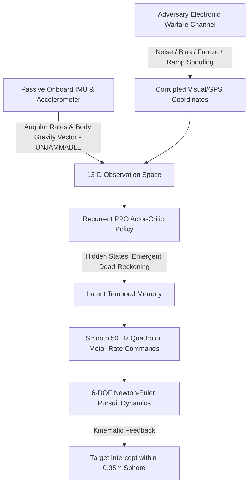

# 🚁 Autonomous UAV Interception Under Adversarial Sensor Jamming

### A Deep Recurrent Reinforcement Learning Framework (LSTM-PPO) for Resilient UAV Target Pursuit in GPS-Denied & Electronic Warfare Environments

[](https://www.python.org/)
[](https://pytorch.org/)
[](https://gymnasium.farama.org/)
[](https://sb3-contrib.readthedocs.io/)

---

## 💡 Why This Project Matters: The Core Problem & Motivation

Autonomous aerial target interception by unmanned aerial vehicles (UAVs) is a critical capability in modern aerospace defense and counter-drone operations. However, existing autonomous guidance algorithms face a catastrophic vulnerability in contested combat zones:

### 1. The Core Problem: The Memoryless Failure under Electronic Warfare (EW)
* **The Fragility of Visual & GPS Telemetry:** Real-world aerial targets deploy active electronic countermeasures—including RF jamming, GPS coordinate spoofing, sensor freezing, and false coordinate injection.
* **The Markovian Trap:** Standard guidance laws and memoryless reinforcement learning models (such as Feedforward PPO or classic PID controllers) assume a fully observable Markov Decision Process (MDP). When an adversary injects sudden coordinate jumps or false drifts, memoryless controllers instantly react to the fake signal, inducing violent high-frequency motor oscillations, trajectory divergence, and catastrophic ground collisions.
* **The Exploration Bottleneck:** A 6-DOF quadrotor is an inherently unstable physical plant. If thrown directly into combat with active jamming and dynamic targets, an uninitialized neural policy crashes 100% of the time, receiving zero positive reinforcement and suffering from severe policy collapse.

---

## 🎯 How We Proposed to Solve It

To solve these challenges, this project introduces a unified aerospace GNC and deep reinforcement learning architecture implemented end-to-end in [`complete_pipeline.ipynb`](file:///c:/Users/SURA/Desktop/reforcement%20learning/complete_pipeline.ipynb):



### Key Architectural Solutions:
1. **Adversarial POMDP Formulation:** We model the mission as a **Partially Observable Markov Decision Process**, directly exposing the agent to 4 realistic electronic warfare attack profiles: **Stochastic Gaussian Noise**, **Constant Coordinate Bias**, **Telemetry Freeze (Packet Loss)**, and **Deceptive Ramp Drift**.
2. **Passive Onboard IMU & Gravity Sensing (13-D State):** While external GPS feeds can be jammed remotely, onboard inertial measurement units (measuring body angular velocities $\omega_{\text{body}}$ and body gravity vector projections $g_{\text{body}} = R^\top \mathbf{e}_z$) operate passively and **cannot be jammed by radio waves**. We feed these uncompromised inertial signals directly into the policy.
3. **Emergent Dead-Reckoning via Recurrent PPO (LSTM-PPO):** By embedding a 2-layer stacked Long Short-Term Memory (LSTM) recurrent network into the actor-critic heads, the agent autonomously preserves kinematic momentum $(h_t, c_t)$. When active jamming strikes, the policy learns to dynamically discount the corrupted coordinate inputs and fly on inertial momentum until intercepting the target.
4. **4-Stage Progressive Curriculum Learning:** Solves the exploration bottleneck by training the agent through an intuitive hierarchy:
   - **Stage 1 (Hover Stability):** Learns roll/pitch attitude balance near a stationary target.
   - **Stage 2 (Spatial Transit):** Learns bank turns and velocity management across the 3D arena.
   - **Stage 3 (Maneuvering Target):** Acquires Line-of-Sight (LOS) predictive guidance against dodging targets.
   - **Stage 4 (Electronic Warfare):** Overcomes active electronic attacks via recurrent temporal filtering.
5. **GNC Closing-Velocity Reward Formulation:** Features a mathematically consistent reward function combining Line-of-Sight closing rates ($-\mathbf{v}_{\text{rel}} \cdot \hat{\mathbf{p}}_{\text{rel}}$), upright attitude bonuses ($g_{\text{body}, z}$), and actuator jerk penalties to prevent motor burnout.

---

## 📁 Repository Structure

```
Reinforcement-Learning-based-LSTM-PPO-for-Autonomous-Drone-Target-Interception-Under-Sensor-Jamming/
├── environment/
│   ├── __init__.py               # Registers 'DroneAntiJammingEnv-v0' & 'CurriculumDroneEnv-v0'
│   ├── drone_env.py              # Main Gym POMDP environment (13-D state, closing velocity reward)
│   ├── drone_dynamics.py         # 6-DOF Quadrotor Newton-Euler physics & gravity vector
│   ├── jamming_model.py          # 4-Mode Adversarial Electronic Warfare Engine
│   ├── target_manager.py         # Dynamic evasion trajectories (Stationary, Linear, Sinusoidal)
│   └── curriculum_env.py         # 4-Stage Progressive Curriculum Environment
├── evaluation/
│   ├── evaluate.py               # Empirical evaluation benchmark across all scenarios & attack modes
│   ├── metrics.py                # Statistical GNC performance metrics (RMSE, Jerk, Survival)
│   └── visualize.py              # Publication-quality figure generation (5 Figures)
├── complete_pipeline.ipynb       # Self-contained end-to-end interactive Jupyter Notebook
├── requirements.txt              # Core Python dependencies & Jupyter Notebook
├── .gitignore                    # Clean Git ignore file
└── README.md                     # Comprehensive project documentation & user guide
```

---

## 🚀 Step-by-Step Installation & Execution Guide

Follow these steps in your terminal or Command Prompt (CMD) to set up and run the project:

### Step 1: Open Command Prompt (CMD) or Terminal
Open **Command Prompt** (CMD) on Windows or your **Terminal** on Linux/macOS.

### Step 2: Clone the Repository
Download the project repository to your local machine:
```bash
git clone https://github.com/surafelasfawosen/Reinforcement-Learning-based-LSTM-PPO-for-Autonomous-Drone-Target-Interception-Under-Sensor-Jamming.git
```

### Step 3: Navigate into the Downloaded Folder
```bash
cd Reinforcement-Learning-based-LSTM-PPO-for-Autonomous-Drone-Target-Interception-Under-Sensor-Jamming
```

### Step 4: Install Dependencies & Jupyter Notebook
Install all required libraries with a single command:
```bash
pip install -r requirements.txt
```
*(If you do not have Jupyter installed yet, you can also install it directly via:)*
```bash
pip install notebook
```

---

## 📓 Running the Pipeline

You have multiple options to execute the pipeline:

### Option A: Interactive Jupyter Notebook (Recommended)
Launch the interactive notebook in your browser:
```bash
jupyter notebook complete_pipeline.ipynb
```
From the top menu, select **Cell** ➔ **Run All** (or execute cells one by one).  
The notebook will automatically:
1. Verify system hardware and create the `results/` and `results/figures/` directories.
2. Train both baseline and recurrent policies in parallel with real-time per-step, per-episode, and per-stage reward outputs.
3. Benchmark the models across all 4 operational flight scenarios and 4 electronic warfare attack modes.
4. Render and export all 5 publication-grade analysis figures to `results/figures/`.

### Option B: Run Headlessly from Command Prompt (CMD)
To execute the entire notebook from the command line without opening a browser:
```bash
jupyter nbconvert --to notebook --execute complete_pipeline.ipynb --output executed_pipeline.ipynb
```

### Option C: Run Benchmark Evaluation Standalone
To evaluate existing checkpoints directly from CMD:
```bash
python evaluation/evaluate.py
```

---

## 🛡️ Adversarial Electronic Warfare Attack Modes

The POMDP observation channel simulates 4 realistic electronic countermeasure modes:
* **Mode 1 - Gaussian Noise:** Stochastic high-variance RF jamming injecting continuous coordinate jitter.
* **Mode 2 - Coordinate Bias:** Abrupt step-offset spoofing pulling the drone off the pursuit vector.
* **Mode 3 - Sensor Freeze:** Total coordinate packet loss where telemetry freezes at the last recorded coordinate.
* **Mode 4 - Deceptive Ramp Spoofing:** Slowly diverging linear drift designed to pull the drone away from the true target.

---

## 📊 Evaluation Metrics

* **Interception Success Rate (%):** Terminal achievement within $0.35\,\text{m}$ capture sphere.
* **Tracking RMSE (m):** Root-Mean-Square Error between actual drone position and true target position.
* **Control Jerk ($s^{-1}$):** Mean squared action derivative $\|\mathbf{a}_t - \mathbf{a}_{t-1}\|^2$ measuring actuator smoothness and motor longevity.
* **Survival Steps:** Flight longevity before arena boundary exit or premature collision.

---

## 🛠️ Built With
* [PyTorch](https://pytorch.org/) - Deep Learning Framework
* [Gymnasium](https://gymnasium.farama.org/) - Reinforcement Learning Environments
* [Stable-Baselines3 & SB3-Contrib](https://sb3-contrib.readthedocs.io/) - Recurrent PPO (PPO-LSTM)
* [Matplotlib & NumPy](https://matplotlib.org/) - 3D Trajectory Visualization & Aerospace Dynamics
