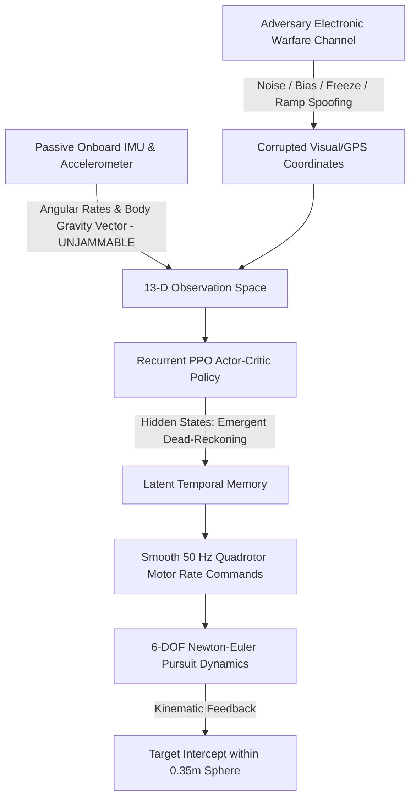

# 🚁 Autonomous UAV Interception Under Adversarial Sensor Jamming

### A Deep Recurrent Reinforcement Learning Framework (LSTM-PPO) for Resilient UAV Target Pursuit in GPS-Denied & Electronic Warfare Environments

**Developer & Author:** [Surafel Asfawosen](https://github.com/surafelasfawosen)  
**Project Domain:** Autonomous Guidance, Navigation & Control (GNC) • Deep Reinforcement Learning • Electronic Warfare Resilient Robotics  

[](https://www.python.org/)
[](https://pytorch.org/)
[](https://gymnasium.farama.org/)
[](https://sb3-contrib.readthedocs.io/)

---

## 💡 Why I Built This Project: The Core Problem & Motivation

Autonomous aerial target interception by unmanned aerial vehicles (UAVs) is a critical capability in modern defense and counter-drone operations. When building this autonomous system, I set out to tackle a major vulnerability that traditional drone autopilots face:

### 1. The Core Problem: The Memoryless Failure under Electronic Warfare (EW)
* **The Fragility of Visual & GPS Feeds:** Real-world aerial targets deploy active electronic countermeasures—including radio-frequency (RF) jamming, GPS coordinate spoofing, telemetry freezing, and deceptive coordinate drift.
* **The Markovian Trap:** Standard guidance algorithms and memoryless deep reinforcement learning policies (such as standard Feedforward PPO or classical PID controllers) assume a fully observable state. When an adversary injects sudden coordinate jumps or false drifts, these controllers immediately react to the fake telemetry, triggering violent roll/pitch motor chatter, trajectory divergence, and fatal ground collisions.
* **The Exploration Bottleneck:** A 6-DOF quadrotor is an inherently unstable physical plant. If I attempted to train an agent directly in active combat from step one, the drone flipped and crashed within fractions of a second, receiving zero positive reinforcement and suffering from complete policy collapse.

---

## 🎯 How I Solved It: My Technical Approach

To solve these challenges, I engineered a complete end-to-end aerospace GNC and deep reinforcement learning pipeline, implemented self-contained in [`complete_pipeline.ipynb`](file:///c:/Users/SURA/Desktop/reforcement%20learning/complete_pipeline.ipynb):



### My Core Engineering Contributions:
1. **Adversarial POMDP Environment:** I modeled the combat flight mission as a **Partially Observable Markov Decision Process**, directly exposing the drone to 4 realistic electronic warfare attack profiles: **Stochastic Gaussian Noise**, **Constant Coordinate Bias**, **Telemetry Freeze (Packet Loss)**, and **Deceptive Ramp Drift**.
2. **Passive Onboard IMU & Gravity Sensing (13-D State):** While external GPS feeds can be jammed remotely, onboard inertial measurement units (measuring body angular velocities $\omega_{\text{body}}$ and body gravity vector projections $g_{\text{body}} = R^\top \mathbf{e}_z$) operate passively and **cannot be jammed by radio waves**. I formulated an augmented 13-dimensional observation vector that couples these clean inertial signals with external target coordinates.
3. **Emergent Dead-Reckoning via Recurrent PPO (LSTM-PPO):** I embedded a 2-layer stacked Long Short-Term Memory (LSTM) recurrent network into the actor-critic architecture. When electronic jamming corrupts coordinate inputs, the policy's latent hidden state $(h_t, c_t)$ autonomously performs **inertial dead-reckoning**, maintaining flight trajectory momentum and successfully tracking moving targets without external guidance.
4. **4-Stage Progressive Curriculum Learning:** To overcome the exploration bottleneck, I structured the agent's learning progression through 4 sequential stages:
   - **Stage 1 (Hover & Balance):** The drone masters attitude stabilization and thrust balance near a stationary target.
   - **Stage 2 (Spatial Transit):** The drone learns banking turns, acceleration, and distance closure across the full 3D arena.
   - **Stage 3 (Maneuvering Target):** The drone acquires predictive Line-of-Sight (LOS) guidance against evading targets.
   - **Stage 4 (Electronic Warfare Attacks):** Active sensor jamming is engaged, forcing the recurrent memory to filter out false telemetry.
5. **Multi-Objective Guidance Reward Function:** I derived and implemented a mathematically unified reward function featuring Line-of-Sight closing velocity ($-\mathbf{v}_{\text{rel}} \cdot \hat{\mathbf{p}}_{\text{rel}}$), upright attitude shaping ($g_{\text{body}, z}$), and actuator jerk penalties to prevent motor burnout.

---

## 📁 Repository Structure

```
Reinforcement-Learning-based-LSTM-PPO-for-Autonomous-Drone-Target-Interception-Under-Sensor-Jamming/
├── environment/
│   ├── __init__.py               # Registers 'DroneAntiJammingEnv-v0' & 'CurriculumDroneEnv-v0'
│   ├── drone_env.py              # Main Gym POMDP environment (13-D state, closing velocity reward)
│   ├── drone_dynamics.py         # 6-DOF Quadrotor Newton-Euler physics & gravity vector
│   ├── jamming_model.py          # 4-Mode Adversarial Electronic Warfare Engine
│   ├── target_manager.py         # Dynamic evasion trajectories (Stationary, Linear, Sinusoidal)
│   └── curriculum_env.py         # 4-Stage Progressive Curriculum Environment
├── evaluation/
│   ├── evaluate.py               # Empirical evaluation benchmark across all scenarios & attack modes
│   ├── metrics.py                # Statistical GNC performance metrics (RMSE, Jerk, Survival)
│   └── visualize.py              # Publication-quality figure generation (5 Figures)
├── complete_pipeline.ipynb       # Self-contained end-to-end interactive Jupyter Notebook
├── requirements.txt              # Core Python dependencies & Jupyter Notebook
├── .gitignore                    # Clean Git ignore file
└── README.md                     # Comprehensive project documentation & user guide
```

---

## 🚀 Step-by-Step Installation & Execution Guide

Follow these steps in your Command Prompt (CMD) or terminal to clone and run my project:

### Step 1: Open Command Prompt (CMD) or Terminal
Open **Command Prompt** (on Windows) or your **Terminal** (on Linux/macOS).

### Step 2: Clone the Repository
Download my project repository:
```bash
git clone https://github.com/surafelasfawosen/Reinforcement-Learning-based-LSTM-PPO-for-Autonomous-Drone-Target-Interception-Under-Sensor-Jamming.git
```

### Step 3: Navigate into the Project Folder
```bash
cd Reinforcement-Learning-based-LSTM-PPO-for-Autonomous-Drone-Target-Interception-Under-Sensor-Jamming
```

### Step 4: Install Dependencies & Jupyter Notebook
Install all project dependencies with pip:
```bash
pip install -r requirements.txt
```
*(If you do not have Jupyter installed yet, install it via:)*
```bash
pip install notebook
```

---

## 📓 Running the Pipeline

You can run my pipeline in multiple ways:

### Option A: Interactive Jupyter Notebook (Recommended)
Launch the interactive notebook in your browser:
```bash
jupyter notebook complete_pipeline.ipynb
```
From the menu, click **Cell** ➔ **Run All** (or execute step-by-step). The notebook will:
1. Initialize the environment and create the `results/` folder structure.
2. Train both baseline and recurrent policies in parallel with live per-step, per-episode, and per-stage outputs.
3. Benchmark the models across all 4 operational flight scenarios and 4 electronic warfare attack modes.
4. Render and export all 5 publication-grade figures into `results/figures/`.

### Option B: Run Headlessly from Command Prompt (CMD)
To execute the entire notebook from the command line without opening a browser:
```bash
jupyter nbconvert --to notebook --execute complete_pipeline.ipynb --output executed_pipeline.ipynb
```

### Option C: Run Benchmark Evaluation Script Standalone
To evaluate existing checkpoints directly from CMD:
```bash
python evaluation/evaluate.py
```

---

## 🛡️ Adversarial Electronic Warfare Attack Modes

I implemented 4 distinct electronic attack modes into the POMDP observation channel:
* **Mode 1 - Gaussian Noise:** Stochastic high-variance RF jamming injecting continuous coordinate jitter.
* **Mode 2 - Coordinate Bias:** Abrupt step-offset spoofing pulling the drone off the pursuit vector.
* **Mode 3 - Sensor Freeze:** Total coordinate packet loss where telemetry freezes at the last recorded coordinate.
* **Mode 4 - Deceptive Ramp Spoofing:** Slowly diverging linear drift designed to pull the drone away from the true target.

---

## 📊 Evaluation Metrics

I evaluate the trained policies using standard aerospace GNC criteria:
* **Interception Success Rate (%):** Terminal achievement within the $0.35\,\text{m}$ capture sphere.
* **Tracking RMSE (m):** Root-Mean-Square Error between actual drone position and true target position.
* **Control Jerk ($s^{-1}$):** Mean squared action derivative $\|\mathbf{a}_t - \mathbf{a}_{t-1}\|^2$ measuring actuator smoothness and motor longevity.
* **Survival Steps:** Flight longevity before arena boundary exit or premature collision.

---

## 🛠️ Built With
* [PyTorch](https://pytorch.org/) - Deep Learning Framework
* [Gymnasium](https://gymnasium.farama.org/) - Reinforcement Learning Environments
* [Stable-Baselines3 & SB3-Contrib](https://sb3-contrib.readthedocs.io/) - Recurrent PPO (PPO-LSTM)
* [Matplotlib & NumPy](https://matplotlib.org/) - 3D Trajectory Visualization & Aerospace Dynamics
